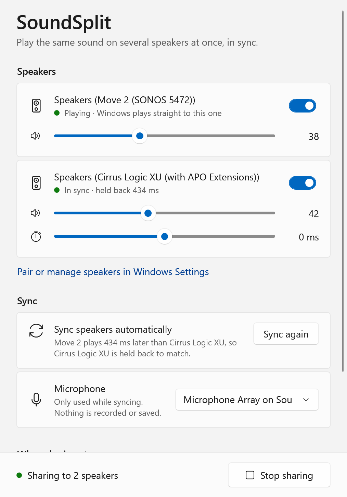
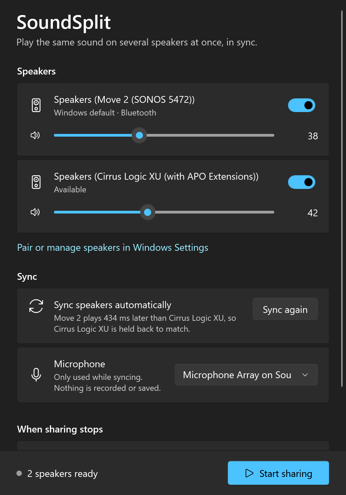

# SoundSplit

Play the same sound on several speakers or headphones at once on Windows 11 — **in sync**.

Windows only plays to one output at a time. SoundSplit copies whatever Windows is playing to
your other speakers, and lines them up so a wired laptop speaker and a Bluetooth speaker a
quarter of a second behind it land together.

- **One-click sync.** Press *Sync now*. Each speaker plays a few short chirps, the PC's
  microphone times their arrival, and SoundSplit works out the delays itself. About three
  seconds per speaker.
- **Stays in sync.** Two devices never run at exactly the same speed, so a fixed delay drifts
  by several milliseconds a minute. SoundSplit tracks both device clocks continuously and
  corrects as it goes.
- **Looks like Windows 11.** Fluent controls, Mica, light and dark, accent colour.
- No driver, no install, no account. Nothing is recorded or sent anywhere.

<p>
  
  &nbsp;
  
</p>

## Download

Get **SoundSplit-x.y.z-win-x64.zip** from the [latest release](https://github.com/ganpatig/SoundSplit/releases/latest),
unzip it anywhere and run `SoundSplit\SoundSplit.exe`. Nothing to install; .NET is included.

Windows 10 (1607 or later) or Windows 11, 64-bit. The app isn't code-signed yet, so the first
time you run it Windows SmartScreen may say it is unrecognised: choose **More info → Run anyway**.

## How to use it

1. Connect your speakers / headphones (pair Bluetooth ones in Windows as usual).
2. Switch on the speakers you want in the list.
3. Press **Sync now** once and keep the room reasonably quiet for a few seconds. Volumes are
   left alone; only if the microphone can't hear a speaker is that one turned up briefly for a
   second try, then put back.
4. Press **Start sharing**.

The measurement is remembered, so next time it is just *Start sharing*. Sync again if you
swap speakers, or if a Bluetooth speaker has drifted after reconnecting (its delay can change
from one connection to the next).

Headphones can't be heard by the microphone. Set those by ear with the timing slider that
appears under each speaker while sharing (drag right to play it later, left for earlier).

## How it works

Sound that Windows plays directly cannot be held back by an app; only the copies the app sends
can. So SoundSplit makes the **slowest** speaker the Windows default — it plays untouched — and
delays every faster speaker to meet it. (As a bonus, video players already compensate for the
default device's delay, so lip-sync stays right too.) When you stop sharing, Windows is
switched back to the speaker it was using.

Under the hood:

- The default device's output is recorded with a WASAPI loopback capture into a few seconds of
  history.
- Each other speaker reads from that history at its own delay through a windowed-sinc
  resampler. A control loop compares the two device clocks on every block and nudges the
  resampling rate by a few parts per million to hold the delay exactly.
- *Sync now* plays a chirp pattern on one speaker at a time and finds it in the microphone
  recording by matched filtering, which is accurate to well under a millisecond even in a
  noisy room. Every speaker is heard by the same microphone, so the microphone's own delay
  cancels out.

Sync is exact **at the microphone**, i.e. at the PC. Sound travels about 3 ms per metre, so if
you sit much closer to one speaker than the PC is, nudge the timing slider to taste.

## Limits

- Speakers that are almost equally fast can end up roughly 20–35 ms apart, because copying
  audio from one device to another takes that long and the direct speaker can't be delayed.
  The status line says so when it happens.
- Bluetooth delay itself (typically 150–250 ms) can't be removed from the PC; it can only be
  matched.
- DRM-protected audio from some store apps is not capturable. Use a browser instead.
- Apps set to play to one specific device (rather than the Windows default) are not shared.

## Build

Requires the .NET 11 SDK.

```powershell
.\build.ps1          # tests, publishes to .\publish\SoundSplit.exe and zips to .\dist
```

GitHub Actions runs the same script on every push. Pushing a `v*` tag also attaches the zip to
that release.

Diagnostics that write a report instead of opening the window:

```powershell
SoundSplit.exe --probe report.txt        # list devices and what they support (silent)
SoundSplit.exe --drytest report.txt 15   # run the engine on real devices, sending silence (silent)
SoundSplit.exe --calibrate report.txt    # measure every speaker with the microphone (plays chirps)
SoundSplit.exe --verify report.txt       # share for real, then time each speaker on its own and
                                         # report how far apart they land (plays chirps)
```

On the development machine (laptop speakers plus a Sonos Move 2 over Bluetooth, 483 ms behind),
`--verify` measured the two landing 0.3 ms apart.

Log: `%LOCALAPPDATA%\SoundSplit\soundsplit.log`. Settings: `%APPDATA%\SoundSplit\settings.json`.

## Credits

Written from scratch. Uses [NAudio](https://github.com/naudio/NAudio) (MIT) for the Windows
audio API bindings. Inspired by the idea behind Double Headphones; shares no code with it.

MIT licensed.
